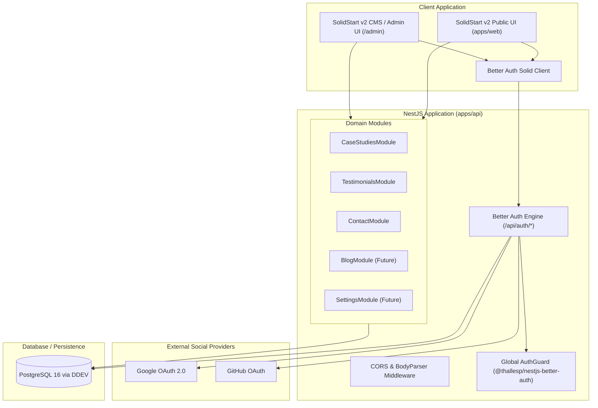

# Comprehensive Migration & Architecture Plan
## SolidStart v2 + NestJS + Better Auth + CMS, Blog & Site Settings

This document contains the complete, step-by-step architectural design and execution plan for pairing **SolidStart v2** with **NestJS**, incorporating **Better Auth** with Google and GitHub social logins, and providing an extensible foundation for a **Blog System**, **Headless CMS**, and **Dynamic Site Settings**.

---

## 1. System Topology & Environment Configuration

### 1.1 Architecture Diagram



---

## 2. Multi-Tier Environment Strategy

All sensitive credentials and environment variables follow a strict 3-tier precedence hierarchy:

```
apps/api/.env.development.local  (Highest precedence - git-ignored)
       ↓
apps/api/.env.development        (Shared development presets - git-ignored)
       ↓
apps/api/.env                    (Base fallback defaults - git-ignored)
       ↓
apps/api/.env.example            (Committed template with placeholder keys)
```

### Configured Environment Variables:
- `PORT=3000`
- `NODE_ENV=development`
- `BETTER_AUTH_SECRET` (Minimum 32-character encryption key)
- `BETTER_AUTH_URL=http://localhost:3000`
- `CLIENT_URL=http://localhost:5173`
- `GOOGLE_CLIENT_ID` & `GOOGLE_CLIENT_SECRET` (dummy values for local dev)
- `GITHUB_CLIENT_ID` & `GITHUB_CLIENT_SECRET` (dummy values for local dev)

---

## 3. Better Auth + NestJS Integration Plan

### 3.1 Backend Configuration (`apps/api`)
1. **Raw Body Handling**:
   - Better Auth requires direct access to incoming raw payloads for webhook and authentication signature verification.
   - Configured in `NestFactory.create(AppModule, { bodyParser: false })`.
2. **Better Auth Engine (`src/auth.ts`)**:
   - Initialized using `betterAuth({ socialProviders: { google, github } })`.
   - Configured with `trustedOrigins` including both API and frontend ports (`http://localhost:5173`).
3. **Module Registration (`src/app.module.ts`)**:
   - Registered using `AuthModule.forRoot({ auth })` from `@thallesp/nestjs-better-auth`.
   - Injects a global `AuthGuard`.
4. **Endpoint Protection Pattern**:
   - **Protected by Default**: Any controller endpoint requires a valid user session.
   - `@AllowAnonymous()` decorator for public portfolio endpoints (`/`, `/health`, `/api/case-studies`, `/api/testimonials`, `/api/contact`).
   - `@Session() session: UserSession` decorator to inject the authenticated user in admin/protected routes.

---

## 4. Phase-by-Phase Roadmap

### Phase 1: Modular Backend Architecture & Infrastructure (Current Focus)
- [x] Create dedicated git branch `migrate/solidstart-nestjs`.
- [x] Setup DDEV container with `ddev-pnpm` (`pnpm v12`).
- [x] Configure pnpm workspace monorepo (`apps/web`, `apps/api`).
- [x] Scaffold latest NestJS v12 with ESM.
- [x] Scaffold latest SolidStart v2 (`@solidjs/start@^2.0.0`) with Vite & TypeScript.
- [x] Set up `.env.*` structure (`.env`, `.env.development`, `.env.development.local`, `.env.example`).
- [x] Connect Better Auth to DDEV PostgreSQL 16 database.
- [x] Refactor `apps/api/src/main.ts` to be ultra-lean and centralize all configuration in `apps/api/src/app.module.ts` (Selective body-parser middleware, `APP_PIPE`, `APP_FILTER`, `APP_GUARD`, `APP_INTERCEPTOR`).
- [x] Implement self-contained, publishable packages under `apps/api/src/packages/`:
  - `packages/auth`: Better Auth engine, OAuth, RBAC roles (`admin`, `editor`, `user`), session decorators, guards, entities, migrations.
  - `packages/logger`: Structured JSON logging, correlation IDs, request latency tracing, logging interceptor.
  - `packages/audit`: Immutable change tracking and audit logs, `@Auditable()` decorator, entity, migrations, repository, service.
  - `packages/report`: Analytics, inquiry volume telemetry, platform summary metrics, exportable reports.
  - `packages/settings`: Dynamic site configuration (key-value + typed settings), public and admin controllers, repository, migrations.
  - `packages/cms`: Core CMS entities (Services, Experience, Testimonials), repositories, migrations, public and admin CRUD endpoints.
  - `packages/blogs`: Production blog engine (posts, categories, tags, markdown parser, read-time calculation, RSS feed, migrations).
  - `packages/case-studies`: Case studies portfolio engine (projects, stacks, metrics, markdown write-ups, related project recommendation algorithm).
  - `packages/contact`: Inquiry handler, spam throttling, PostgreSQL persistence, email delivery via Nodemailer to DDEV Mailpit.

---

### Phase 2: Verification, Migrations & Package Independence
- [x] Execute package SQL migrations against PostgreSQL 16 in DDEV.
- [x] Unit & integration tests for all packages via Vitest.
- [x] Validate publishable package metadata (`package.json`, export barrels `index.ts`).

---

### Phase 3: Future Frontend Dynamic Migration (`apps/web`)
- [ ] Centralize API client in `apps/web/src/lib/api.ts` pointing to NestJS API.
- [ ] Hydrate all frontend sections (Hero, Services, Experience, Case Studies, Testimonials, Contact Form) dynamically from the modular API packages.
- [ ] Connect SolidStart admin dashboard (`/admin`) using Better Auth Solid client.
